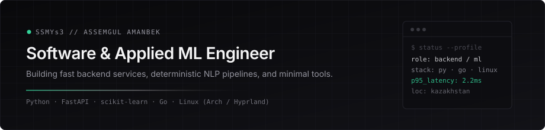

<p align="center">
  
</p>

### Focus

- **Applied NLP & Triage Systems** — low-latency text classification (`TF-IDF`, linear models, hybrid rule/RAG engines) with strict zero-hallucination guarantees.
- **Backend Engineering** — clean REST APIs (`FastAPI`, `Pydantic`, `Uvicorn`), deterministic pipelines, and lightweight web workspaces.
- **Environment** — Linux (`Arch` / `Hyprland` / `Neovim`), automation, and algorithmic problem solving in `Python` & `Go`.

---

### Selected Work

| Project | Stack | Description |
| :--- | :--- | :--- |
| **Grand Mobile Support Copilot** *(Decentrathon 6.0)* | `Python` `FastAPI` `scikit-learn` | Multilingual (`RU`/`KK`/`UZ`) support triage & RAG rule-citation service. `95.8%` accuracy, `0%` rule hallucinations, `2.25 ms` p95 latency on CPU. |
| [**a-regular-pong**](https://github.com/Ssmys3/a-regular-pong) | `Python` `Pygame` | Arcade Pong implementation with custom physics and gameplay mechanics. |
| [**Not_TicTacToe**](https://github.com/Ssmys3/Not_TicTacToe) | `Python` | Extended grid strategy game with custom win-state logic. |
| [**Daily.meme_bot**](https://github.com/Ssmys3/Daily.meme_bot) | `Python` `Bot API` | Automated media delivery and scheduling bot. |

---

### Toolchain

```text
languages   :: Python, Go, SQL, JavaScript / HTML / CSS
ml & data   :: scikit-learn, NumPy, JSONL streaming, TF-IDF / RAG indexing
backend     :: FastAPI, Pydantic, Uvicorn, REST / OpenAPI
system      :: Arch Linux, Hyprland, Git, Make, SSH / WireGuard
```
